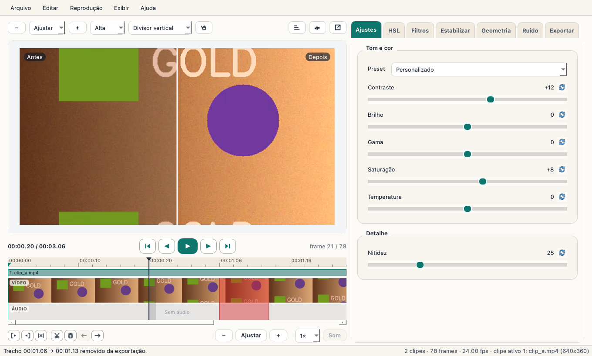
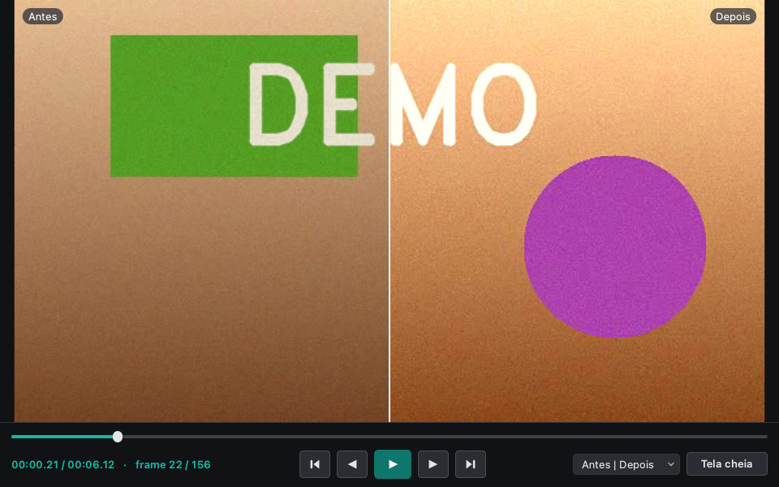

# Space Video Enhancer

Editor de vídeo offline para desktop, **multiplataforma** (macOS, Linux e Windows): abre arquivos locais, mostra **antes e depois** lado a lado enquanto você ajusta estabilização, ruído, cor e geometria, monta uma sequência de clipes com cortes, e exporta no seu computador. Nada sai da máquina.

[](https://github.com/OWNER/space-video-enhancer/actions/workflows/ci.yml)




## Funcionalidades

**Preview e comparação**
- Quatro jeitos de comparar antes e depois — divisor vertical ou horizontal arrastável, lado a lado ou um sobre o outro (seletor ao lado da qualidade); zoom por percentual (100% = 1:1) ou ajustado à janela, com a ferramenta de mão (H, ou o botão do meio do mouse) para arrastar a imagem ampliada; modos de qualidade (alta, balanceado, rápido) que só afetam a tela — a exportação é sempre completa.
- Reprodução em tempo real ou câmera lenta (½×, ¼×) com o som dos clipes em sincronia, pulando os trechos removidos.
- **Preview em janela separada** para uma segunda tela: frame sobre fundo escuro, controles de transporte, tela cheia (F11); a janela principal para de desenhar o frame enquanto ele está lá.
- HUD de métricas (tempo de render por estágio, fila, decode) e vetores de movimento da estabilização sobre a imagem.

**Sequência e cortes**
- Vários arquivos na mesma linha do tempo (faixa de clipes, filmstrip e forma de onda por arquivo); dividir no playhead, remover, reordenar arrastando.
- Cada clipe tem seus próprios ajustes — as abas mostram os do clipe sob o playhead.
- Marcadores de início/fim e trechos removidos de dentro do vídeo (vídeo e áudio), editáveis direto na linha do tempo.
- Desfazer/refazer com rótulos ("Desfazer ajuste de estabilização"); projetos salvos em JSON legível (`.svep`) com lista de recentes.

**Processamento** (OpenCV, CPU ou OpenCL)
- **Estabilização**: suavizar tremor (deslocamento, +rotação e zoom, +perspectiva), travar uma região (*camera lock*) ou híbrida; intensidade, suavização temporal, crop automático. O estimador escolhe a hipótese de movimento que se **espalha** pelo quadro, então uma pessoa cobrindo metade do frame não vira "a câmera".
- **Ruído**: NLMeans desligado, manual, automático pelo frame ou por uma amostra escolhida no preview.
- **Cor**: contraste, brilho, gama, saturação, temperatura e nitidez com presets de *look*; balanço de branco por região cinza ou *gray world*, tint, ajuste de matiz/saturação/luminância por oito faixas de matiz; trava de exposição para câmeras em auto-exposição.
- **Geometria**: crop interativo com proporções, rotação 90°/180°/270° e espelhamento.
- **Artefatos de captura**: desentrelaçamento (detector de "pente" que avisa se o arquivo parece entrelaçado; modo adaptativo refaz só as linhas em movimento, modo campo único remove tudo) e correção de *rolling shutter*: a inclinação constante de uma panorâmica (slider com o tempo de leitura do sensor) e, automaticamente, a **oscilação** (*jello*) do tremor forte — cada frame esticado ou inclinado de um jeito — medida pela diferença de movimento entre o topo e a base do quadro, sem calibração.

**Exportação**
- FFmpeg só para encode e mux do áudio original; tenta NVENC/VAAPI e cai para `libx264` sozinho. MP4 `yuv420p` com `+faststart`, pronto para QuickTime, iOS e decoders de hardware.
- Progresso, cancelamento (apaga o parcial) e paralelismo configurável.

## Instalação

Requisitos: **Python 3.9 a 3.13** (3.11 ou 3.12 recomendado; em 3.9 o pip instala o PySide6 6.10, o último com suporte a ele) e **FFmpeg** no `PATH`. O mesmo código roda nos três sistemas — Qt, OpenCV e FFmpeg cuidam das diferenças — e o app só consulta o sistema para detalhes de integração (ícone na taskbar, dicas do diagnóstico, dispositivo VAAPI):

| Sistema | Estado | Observações |
|---|---|---|
| macOS (Apple Silicon e Intel) | Desenvolvido e usado aqui | OpenCL no denoise; o nome na barra de menus fica "Python" fora de um `.app` |
| Linux (Ubuntu 22.04/24.04) | Testado regularmente | OpenCL, NVENC e VAAPI quando disponíveis ([docs/GPU.md](docs/GPU.md)); `scripts/install-desktop-entry.sh` para nome e ícone no dock |
| Windows 10/11 | Deve funcionar, não validado com frequência | `run.ps1`/`run.cmd` no lugar de `run.sh`; NVENC via FFmpeg com `nvenc`; abra uma issue se algo falhar |

```bash
# macOS
brew install ffmpeg

# Ubuntu/Debian (veja docs/GPU.md para OpenCL e NVENC)
sudo apt install ffmpeg python3-venv

# Windows (PowerShell)
winget install --id Python.Python.3.12 -e
winget install --id Gyan.FFmpeg -e
```

Clone e rode:

```bash
git clone https://github.com/OWNER/space-video-enhancer.git
cd space-video-enhancer
./run.sh        # macOS e Linux
.\run.ps1       # Windows (PowerShell) — ou clique duas vezes em run.cmd
```

Os dois fazem o mesmo: criam a `.venv`, instalam as dependências quando o projeto muda e abrem a interface. Manualmente:

```bash
python3 -m venv .venv && source .venv/bin/activate   # Windows: .\.venv\Scripts\Activate.ps1
python -m pip install .
space-video-enhancer          # ou: python -m space_video_enhancer
```

### Nome e ícone no sistema

O app já define nome, ícone e id de aplicação (`space-video-enhancer`), então a janela, o Alt-Tab e o Dock mostram o ícone próprio. No **Linux**, para o dock e o menu de aplicativos também mostrarem o nome certo em vez de "python", instale a entrada de menu uma vez:

```bash
./scripts/install-desktop-entry.sh        # --remove desfaz
```

No **macOS**, o nome na barra de menus continua "Python" enquanto o app roda direto do interpretador — só um `.app` empacotado (PyInstaller/briefcase) muda isso; o ícone do Dock já é o do app.

## Uso

1. **Arquivo › Abrir vídeo…** (Ctrl+O). Arraste o divisor no preview para comparar; ajuste nas abas à direita.
2. **Arquivo › Adicionar vídeo à sequência…** (Ctrl+Shift+O) para juntar mais arquivos (mesmo fps). Use as ferramentas sob a linha do tempo para marcar início `[` e fim `]`, remover um trecho, dividir, remover ou mover o clipe sob o playhead.
3. **Estabilizar**: escolha o modo; em *camera lock* arraste o retângulo verde sobre a região que deve ficar parada e use "Usar este frame como referência" para fixar o frame de referência.
4. **Ruído**: no modo *amostra*, arraste o retângulo azul sobre uma área lisa da imagem.
5. **Exportar** (Ctrl+E): a aba mostra o resumo (trecho, trechos removidos, tamanho de saída) e o botão. **Arquivo › Salvar projeto** (Ctrl+S) guarda tudo para continuar depois.

Para uma segunda tela: **Exibir › Preview em janela separada** (Ctrl+Shift+D), arraste a janela (ou "Outra tela") e F11.



### Atalhos

| Ação | Atalho |
|---|---|
| Abrir vídeo / adicionar à sequência | Ctrl+O / Ctrl+Shift+O |
| Abrir, salvar, salvar projeto como | Ctrl+P, Ctrl+S, Ctrl+Shift+S |
| Exportar | Ctrl+E |
| Desfazer / refazer | Ctrl+Z / Ctrl+Shift+Z ou Ctrl+Y |
| Reproduzir ou pausar | Espaço |
| Primeiro / último frame, frame anterior / próximo | Home / End, ← / → |
| Marcar início / fim do trecho exportado | I / O |
| Iniciar ou terminar um trecho removido no frame atual | X |
| Remover o corte selecionado | Delete |
| Dividir o clipe no playhead | Ctrl+K |
| Restaurar o preset ativo | Ctrl+R |
| Zoom do preview: ajustar, mais, menos | Ctrl+0, Ctrl++, Ctrl+− |
| Mão: arrastar o preview ampliado | H (o botão do meio arrasta sempre) |
| Métricas / vetores de movimento | Ctrl+M / Ctrl+Shift+M |
| Preview em janela separada | Ctrl+Shift+D |
| No monitor: tela cheia, sair, fechar | F11 ou clique duplo, Esc, Ctrl+W |

As teclas sem modificador só agem quando o widget focado não as usa (um slider focado mantém as setas). No macOS, Ctrl é ⌘.

## Como funciona

- O **pipeline é puro**: `render_frame(frame, settings)` não lê widgets nem estado global. A interface lê os controles uma vez, monta um `RenderSettings` imutável e o entrega ao worker de preview, às miniaturas e à exportação — o que o preview mostra é exatamente o que sai no arquivo.
- Ordem fixa: correções de captura (desentrelaçar, no tamanho nativo) → estabilização (com o rolling shutter) → filtros (inclui escala) → preset → geometria → crop.
- **Nada por frame na GUI thread**: decodificação e render acontecem em um `QThread` com caixa postal "o último vence"; o filmstrip, a forma de onda e o áudio têm threads próprias.
- O modelo (`Sequence` de `Clip`s, `RenderSettings`) é imutável, então desfazer/refazer é só guardar referências e um projeto é a serialização direta do estado.

```
space_video_enhancer/
  settings.py, sequence.py, timeline.py, project.py   # modelo imutável, sequência, cortes, projetos
  video.py, audio.py                                    # decodificação de frames e de PCM
  pipeline/                                             # render_frame e cada etapa (filtros, denoise, grade, geometry, stabilization/)
  export/                                               # ffmpeg, job puro e adaptador QThread
  ui/                                                   # janela (main_window + sections/ por assunto), abas, widgets, workers, monitor
  telemetry/                                            # log estruturado em JSON
tests/                                                  # pytest, roda sem display
benchmarks/                                             # medições que justificaram os algoritmos
```

Se a janela sumir do nada (falha fatal dentro do Qt, OpenCV ou numpy), a pilha de todas as threads fica em `~/.space-video-enhancer/logs/crash.log` — na abertura seguinte a barra de status avisa e aponta para o arquivo (`Ajuda › Abrir pasta de logs`). Exceções Python comuns vão para `app.jsonl` como `app.unhandled` e não fecham o app.

Detalhes e decisões de cada parte em [docs/ARQUITETURA.md](docs/ARQUITETURA.md). Aceleração por GPU (OpenCL, NVENC, VAAPI) e como configurar no Linux em [docs/GPU.md](docs/GPU.md). Eventos de log e como analisá-los em [docs/TELEMETRIA.md](docs/TELEMETRIA.md).

## Desenvolvimento

```bash
python -m pip install -e ".[dev]"
ruff check . && ruff format --check .
mypy space_video_enhancer
QT_QPA_PLATFORM=offscreen pytest
```

Os testes de interface rodam offscreen (sem display) e verificam layout, atalhos e fluxos completos com vídeos sintéticos; os de exportação usam o `ffmpeg` do `PATH` e são pulados se ele não existir. Os testes que tocam Qt levam a marca `ui` — `pytest -m "not ui"` é o loop rápido (pipeline e modelo, ~6 s); a suíte inteira é o critério. `benchmarks/` tem os scripts de medição (tremor residual, custo dos estimadores, variantes de denoise) — veja [benchmarks/README.md](benchmarks/README.md).

## Limitações conhecidas

- Todos os clipes de uma sequência precisam ter o mesmo fps.
- Mídia que mudou de lugar é marcada no projeto, não religada: coloque o arquivo de volta e reabra.
- Arquivos com mais de 30 min tocam sem som no preview (o PCM não caberia com folga na memória); a exportação não é afetada.
- Interface em português.

## Licença

[MIT](LICENSE). Depende de [PySide6](https://pypi.org/project/PySide6/) (LGPL), [OpenCV](https://opencv.org/) (Apache 2.0) e chama o [FFmpeg](https://ffmpeg.org/) instalado no sistema como processo externo.
